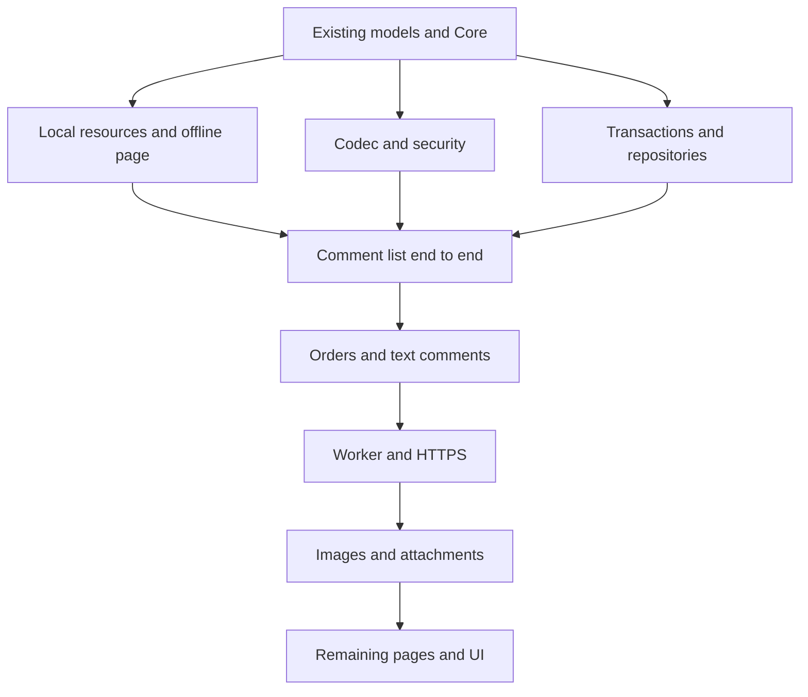

# 按类依赖推进的实现指南

建议采用这个顺序：**本地资源 → 本地页面 → 编码、安全与事务基础 → 评论查询闭环 → 订单写入 → 评论写入 → Worker与HTTPS → 图片资源 → 完整UI**。每个阶段完成一条可运行的流程，再向同类功能扩展。

这样安排的原因是：页面依赖本地目录和资源映射，业务处理依赖身份与仓储，写操作依赖事务和幂等，网络与线程负责把已验证的业务接起来。先把被调用者做实，再实现调用者，可以逐层缩小调试范围。

文中的类名均位于`src/main/java/edu/nju/sehw/takeout/`下；包名用于定位文件。新增实现会明确标为“新增”。

## 现有基础直接复用

`client.core`中的`Core`、`RelationTable`、`MessageParticipant`已经实现注册、路由、权限关系及消息快照。`TaskPool`已经实现有界队列，`ServerOperationCatalog`已经实现操作编号索引。共享的record、枚举及载荷类型已经提供现有字段的构造校验与复制行为。

你正在看的[CommentRequestContext](../src/main/java/edu/nju/sehw/takeout/client/comment/CommentRequestContext.java)用于保存一次评论操作的身份、来源UI和参数，可以直接作为后续`CommentService`的上下文使用。它后面的实际工作集中在`parse`、请求分发、附件协调及结果回传。

先阅读现有测试，掌握Core接入与值对象约定，再从第一阶段开始增加行为。已有测试入口与覆盖内容见[测试说明](testing.md)。

## 依赖主线

下图表示实现阶段的先后依赖。同一阶段先覆盖当前用例需要的方法。



## 第一阶段：本地资源与页面

先完成一张只有本地布局、静态文字和图片的首页。准备一份页面清单样例，固定`pageId`、`elementId`及`LocalResourceRef`与实际文件之间的对应关系。

按以下顺序实现：

1. `client.resource.FileUiLibrary.findPage`：按页面编号读取清单，返回`PageResourceManifest`。
2. `client.resource.FileLocalResourceStore.contains/resolve`：根据本地编号查文件，完成资源是否存在与实际路径的转换。
3. `client.ui.UiResourceForest.install/bind/findPage`：安装页面树，把元素编号绑定到资源引用，再按页面编号取回。
4. `client.security.SessionPermissionChecker.check`：使用测试会话实现客户端权限预检查。
5. `client.logic.PageCatalogService.parse/lookupPage`：接收页面请求，检查权限，调用`LocalUiLibrary`并通过Core回传清单。
6. `client.logic.ResourceAcquisitionService`：完成清单中本地资源的收集与`ResourceBundle`回传。
7. `client.processing.PageProcessor`：先实现`parse`、`handlePage`、`handleHomePage`、`assemblePage`和`returnToUi`。
8. `client.ui.UiInteractionController`与`client.processing.EventProcessor`：实现页面输入、`pageHandler`、页面接收和基础绘制入口。

这一阶段的调用顺序是：

```text
UiInteractionController.receiveUiInput
  → Core → EventProcessor.pageHandler
  → Core → PageProcessor.handleHomePage
  → Core → PageCatalogService / ResourceAcquisitionService
  → Core → PageProcessor.assemblePage
  → Core.getTargetRef → UiDataPort.receivePage
  → UiThreadDispatcher → render
```

测试中为`UiThreadDispatcher`提供立即执行的实现，或记录待绘制任务；为UI保留一个可以观察页面数据的接收端。每次增加参与者，都在测试组装处创建实例、`register`并`allow`所需路由。

**阶段验收：**输入首页编号后，能够取得布局、资源绑定和最终`UiPage`；切换两次页面并反向交付结果时，UI显示最后一次请求的页面。

## 第二阶段：编码、安全与事务基础

这三组工作各自从接口实现开始，完成后供下一阶段共同使用。

| 分组 | 实现顺序 | 产出 |
| --- | --- | --- |
| 报文 | 新增`MessageCodec`实现 → 请求与响应外层编解码 | 消息及各类载荷可以往返传输，双方使用相同字节计算摘要 |
| 身份 | 新增`ServerSessionStore`实现 → `DefaultRequestSecurity` → `DefaultServerRequestVerifier` → `DefaultServerPermissionChecker`的评论读取权限 | 客户端封装凭据与时间，服务器还原真实主体并检查操作权限 |
| 持久化 | 数据库表与测试数据 → `DataSource`配置 → 新增`TransactionContext`实现 → `JdbcDatabaseAdapter.inTransaction` → `executeWithinTransaction` | 一个操作可以在同一连接中读取、写入、提交或回滚 |

`MessageCodec`先覆盖`Message`、编号、UUID以及当前评论查询载荷，随后随功能增加其它载荷。为字段顺序、数字、空值、枚举和字节数组确定统一编码规则。先准备固定的字节样例，再验证编码、解码及摘要的一致性。

会话存储可以先用测试账号组成的内存实现。`DefaultRequestSecurity`使用`ClientSession`、编码器及`Clock`准备请求；服务器验证器通过会话存储取得主体，并验证编号、时间与摘要。用固定Clock测试正常请求、过期、错误摘要和未知凭据。

`JdbcDatabaseAdapter`同时实现`DatabaseAdapter`和`TransactionRunner`。`inTransaction`负责取得连接、关闭自动提交、执行回调、成功提交、失败回滚和释放连接；`TransactionContext`把这条连接传给内部操作。JDBC连接默认自动提交，显式事务需要统一管理提交与回滚。[JDK Connection说明](https://docs.oracle.com/en/java/javase/23/docs/api/java.sql/java/sql/Connection.html)

**阶段验收：**报文往返后保留原请求内容；有效会话通过验证；事务内第二次写入抛异常时，第一次写入也回滚；回调中的仓储访问使用同一连接。

## 第三阶段：打通无图片评论列表

选择`COMMENT_LIST(4101)`作为第一条业务流程。它有明确的领域载荷和结果类型，可以串起页面、评论服务、查询层与服务器。初始数据使用几条没有图片的评论。

先从服务器内部向客户端实现：

1. `server.comment.JdbcCommentRepository.listPage`：实现可见评论、排序及游标分页的查询和对象映射。
2. `server.comment.CommentOperationHandler.list/handle`：解析`ListCommentPayload`，创建查询并返回评论结果。
3. 操作注册数据：为`ServerOperationCatalog`提供4101的权限、字段及事务策略。
4. `server.operation.ServerOperationExecutor.execute`：完成查目录、校验参数、授权、事务内调用评论处理器、构造`SecureResponse`的读取分支。
5. `client.query.DatabaseGateway`：完成`parse → executeOperation → onReply`，保留`ReplyRoute`并按结果回传。
6. `client.comment.CommentService`：先实现列表请求的`parse`、`handle`、`submitOperation`和`returnResult`。
7. `PageProcessor.handleCommentListPage`：取得评论数据，装配字段并交付UI。

此时在测试中新增一个`HttpsTransport`替身：把`SecureRequest`交给真实验证器，构造`VerifiedTask`，调用真实`ServerOperationExecutor`，再通过`CompletionStage`把响应交回客户端。它把现有两端连成一个可调试的进程内流程。

构造器要求的其余依赖由测试替身补齐；每个替身只实现本用例需要的行为，意外调用立即使测试失败。

**阶段验收：**从页面请求开始，真实查询测试数据库并回到UI。覆盖空列表、不同排序、下一页、权限拒绝，以及两个页面请求的响应交错。

## 第四阶段：订单写入、事务与并发

读取流程稳定后，接入第一次状态变更。先准备一张`QUEUED`订单，完成“客户取消”和“商家开始制作”两个竞争操作，再扩展其它订单事件。

实现顺序为：

1. 新增`OrderRepository`、`ExceptionCaseRepository`的具体实现，先完成现有查询、条件更新及工单接口。
2. `OrderRepository.find/transition`：条件更新同时匹配订单编号、预期状态和版本；更新成功后增加版本。
3. `JdbcIdempotencyStore.claim/complete`：按主体与`requestId`建立去重记录，保存摘要及可重放结果。
4. `OrderOperationHandler.handle`：查询目标、校验主体与状态、调用条件更新并形成业务结果。
5. `ServerOperationExecutor.execute`的写入分支：在同一事务内组织claim、业务修改和complete。
6. `client.logic.CrudOperationService.parse/planOperations`：把一个UI事件拆成有明确编号及参数的请求。
7. `EventProcessor`：补`handleCancelOrder`与`handleStartPreparation`，然后逐个增加其余订单策略。

两个竞争操作使用不同请求编号、相同预期版本。数据库条件更新成功的一方推进订单，另一方得到冲突结果。相同请求的重试沿用原编号，并取得对应的去重结果。

接下来补充下单所需载荷与创建方法，实现下单、取餐、送达、客户确认及“未收到”。“未收到”在同一事务中把订单改为`EXCEPTION`并创建沟通工单；工单结案保存处理结果。

**阶段验收：**取消与开始制作同时发生时，只有一个成功；同一请求重复提交只产生一次业务效果；任一步骤失败时，订单、工单和幂等终态一起回滚。两组用例都使用真实数据库事务和独立连接。

## 第五阶段：纯文字评论的发布与管理

这一阶段复用订单、事务、身份和幂等基础。先完成纯文字评论，再增加附件。

按`TextLengthPolicy`具体实现 → `DefaultPurchaseEvidenceResolver` → `JdbcCommentRepository`写入方法 → `CommentOperationHandler`各策略 → `CommentService` → `EventProcessor`的顺序推进。

每完成一个服务器策略，就接通对应客户端策略：

| 服务器策略 | 客户端事件策略 | 验证结果 |
| --- | --- | --- |
| `publish` | `handlePublishComment` | 正文和购买标记落库，重新读取可见 |
| `withdraw` | `handleWithdrawComment` | 作者撤回后，列表按可见性规则刷新 |
| `reply` | `handleMerchantReply` | 对应商家的回复保存并显示 |
| `hide` | `handleHideComment` | 平台操作后，列表按隐藏规则刷新 |

`CommentRequestContext`在这里保存根操作、子请求及来源UI。`CommentService`负责从开始到成功或失败的上下文管理；购买标记由服务器依据订单记录生成。

**阶段验收：**发布后查询、作者撤回、商家回复和平台隐藏分别形成完整流程；跨用户、跨商家操作返回授权结果，重试保持一次生效。

## 第六阶段：Worker、接收端与真实HTTPS

把第三至第五阶段使用的进程内传输替换为网络连接。先完成服务器内部交接，再接客户端HTTP适配器：

1. `ResponseSender.reply`：通过`ReplyChannel`发送对应请求的响应。
2. `Worker.parseTask/run`：从`TaskPool.take`取得任务，在队列外交给`OperationExecutor`，再发送响应；实现中断退出和单项任务异常后的处理。
3. `ServerReceiver.receive`：验证请求并入队，队列满时回复`BUSY`。
4. 新增HTTPS服务器入口及`ReplyChannel`实现：负责请求解码、调用接收者和响应编码。
5. `JdkHttpsTransport.submit`：编码请求、发起HTTPS调用、解码响应并完成异步阶段。
6. 组装服务器和客户端启动入口，登记会话、操作目录、Core参与者及路由。

把`DatabaseGateway`的测试替身替换为`JdkHttpsTransport`，重跑已有业务流程。传输层异常交给异步完成分支，业务状态由`SecureResponse.status`传回。`CompletionStage`提供正常和异常完成后的组合处理；本项目在回调中完成结果归还及pending记录清理。[JDK CompletionStage说明](https://docs.oracle.com/en/java/javase/23/docs/api/java.base/java/util/concurrent/CompletionStage.html)

**阶段验收：**真实HTTPS下的评论读取和订单写入通过；覆盖队列满、处理器抛异常、连接中断、重试以及Worker停止。

## 第七阶段：图片下载、上传及带图评论

先让客户端取得并缓存服务器已有图片，再接上传，最后让评论引用附件。

下载按以下顺序实现：

`FileServerResourceStore.read → ServerOperationExecutor的GET_RESOURCE分支 → FileLocalResourceStore.save → ResourceGetTool → ResourceAcquisitionService的远端分支 → PageProcessor的图片装配`。

上传按以下顺序实现：

`FileServerResourceStore.write/checkOwned → ServerUploadHandler.handle → ServerReceiver.receiveUpload/stageUpload → JdkHttpsTransport.upload → ResourceUploadTool → CommentService.uploadAttachments`。

为上传补齐本地引用到文件内容的读取，以及临时文件、资源登记和返回资源编号。`CommentService`等待所有附件上传成功后，使用这些编号提交评论；每项子请求使用独立`requestId`，整个操作共享`correlationId`。

**阶段验收：**带图评论发布后可以重新读取；第二次查看命中本地缓存；上传失败能结束当前操作并显示结果；其它用户的附件由服务器检查归属。

## 第八阶段：补齐页面策略与实际UI

已有业务能力分别接入`PageProcessor`的订单详情、商家营业额、评论排序与翻页、骑手任务等策略，并补齐`EventProcessor`对应事件。为新增查询登记操作元数据和载荷，沿现有查询闭环实现。

最后实现UI工具包对应的`UiThreadDispatcher`和实际`render`，把按钮、页面切换与数据字段绑定到`UiInput`、`UiPage`。从首页逐页检查客户、商家、骑手和平台的主要操作，并在界面中显示处理中、成功、业务拒绝及传输失败的结果。

**阶段验收：**客户端与服务器分别启动；从UI完成查看、下单、状态推进、未收到、评论及附件操作；已有流程和回归测试通过。

## 每实现一个方法时的工作顺序

先看Javadoc和当前用例，明确输入载荷、返回载荷、调用对象及状态变化；再写一个成功用例和相关失败用例，完成当前方法，接到上一层的一个策略。上下文与pending记录分别验证成功、业务拒绝和异常完成后的清理。

修改后在项目根目录执行：

```powershell
# Run tests after implementing one behavior.
powershell -NoProfile -ExecutionPolicy Bypass -File tools/maven.ps1 test

# Format and verify a completed stage.
powershell -NoProfile -ExecutionPolicy Bypass -File tools/maven.ps1 fmt:format verify

# Validate API documentation after changing a contract.
powershell -NoProfile -ExecutionPolicy Bypass -File tools/javadoc.ps1
```

**现在的第一步就是实现`FileUiLibrary.findPage`，配一份真实页面清单及“找到／未找到”的测试；随后实现`FileLocalResourceStore.contains/resolve`和`UiResourceForest`，让首页形成第一次完整回传。**

## P.S. 接到相应阶段时需要补齐的设计

1. **编码与接入端口。**当前`MessageCodec`只接受`Message`，HTTPS还需要`SecureRequest`与`SecureResponse`外层编解码；可以新增独立的报文编码端口。第二阶段同时定好它与消息编码器的关系。`HttpsTransport`是客户端端口，服务器HTTPS监听、请求体读取和`ReplyChannel`适配器需要新增。
2. **具体实现与配置。**当前`ServerSessionStore`、`TransactionContext`、`TextLengthPolicy`、`OrderRepository`和`ExceptionCaseRepository`提供接口，指南已安排其实现。数据库类型、JDBC驱动、清单格式、HTTPS配置及UI工具包在对应阶段选定；本指南保留现有Maven结构。
3. **异步页面装配。**`UiPageAssembly`目前要求清单、资源和字段全部存在。第三阶段接入异步查询前，增加一个表达“等待中”的装配状态，完成后生成现有`UiPageAssembly`。`ResourceAcquisitionService.acquire`目前同步返回本地引用；远端分支应使用消息回调聚合或调整为异步返回，并保存按请求编号组织的收集状态。
4. **订单操作目录。**当前`OrderRepository`只有查询及状态更新，`OrderCommandPayload`只有订单编号和版本。下单需要创建方法及菜品、数量等载荷。`OrderStatus`还含待接单、待取餐等状态，应对照实验二订单状态图补齐商家接单／拒绝、制作完成等操作编号与策略，使每条状态边都有触发入口。
5. **对象授权。**`DefaultServerPermissionChecker`当前没有仓储依赖，`TargetDescriptor`只提供对象类型与编号。第四阶段应补充对象归属查询，或由业务处理器在当前事务中取得对象并校验；订单、评论、门店和附件的授权依据由服务器读取。
6. **资源与事务。**`JdkHttpsTransport.upload`接收本地资源引用，需要补充引用解析及文件读取依赖。图片文件与数据库登记分别落地，第七阶段需安排暂存、失败回收和一致性处理。摘要用于检查报文内容，身份可信性由会话验证与HTTPS承担。
7. **验证记录。**现有40项测试对应此前框架。本页列出的各阶段验收是后续实现目标；本次交付为指南及导航更新。实验三报告由你按课程要求自行撰写。
